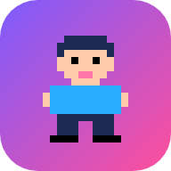
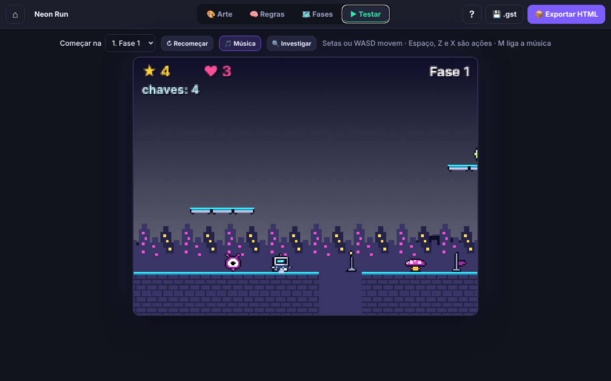
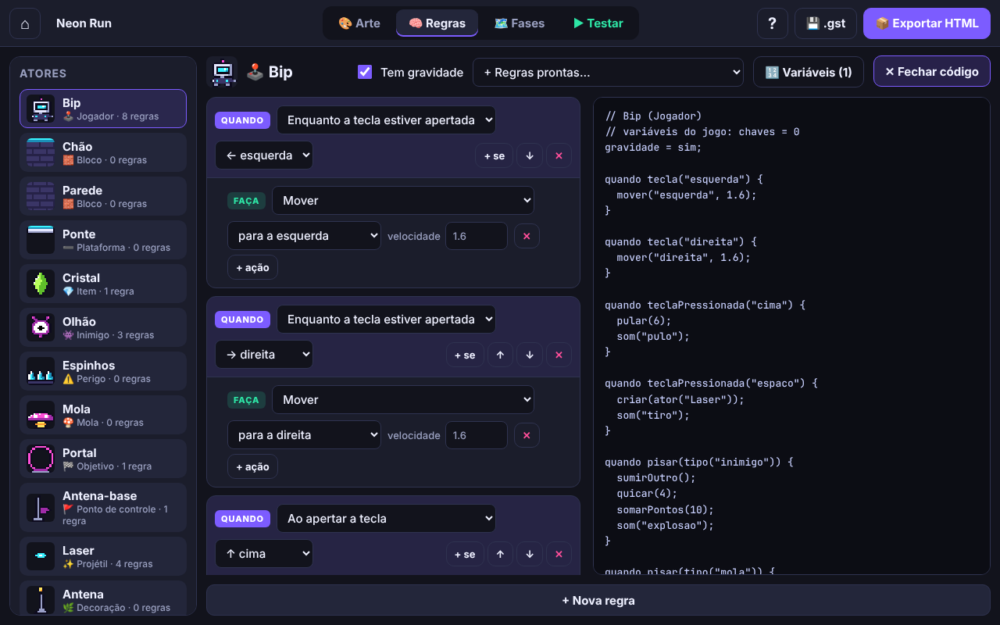
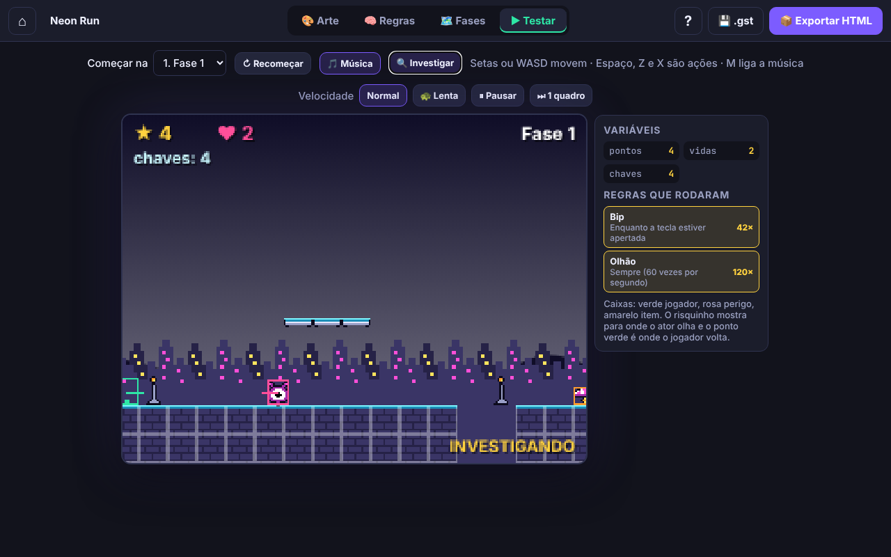
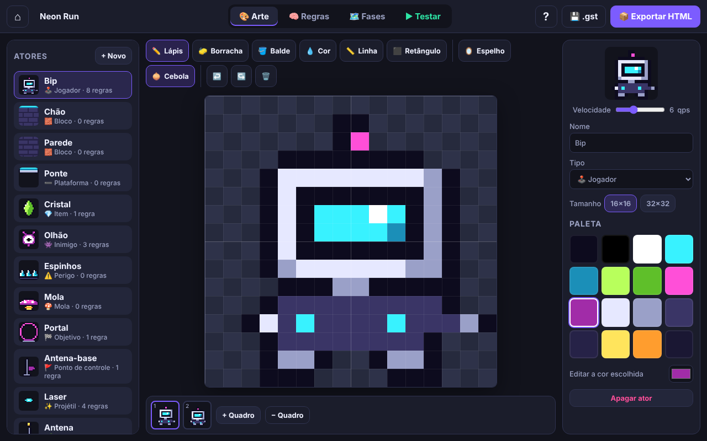
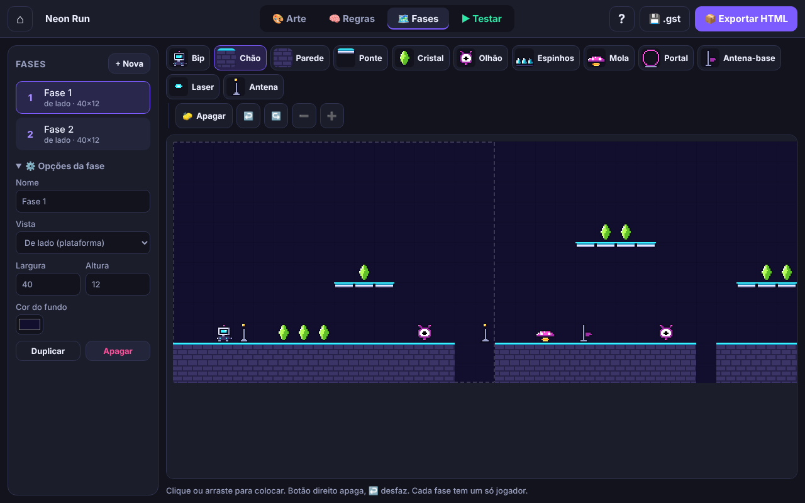

<p align="center">
  
</p>

<h1 align="center">Game Studio Teen</h1>

<p align="center"><strong>Draw the actors. Write the rules. Ship the game.</strong></p>

<p align="center">
  <a href="https://gamestudio42.github.io/gamestudio-teens/"></a>
  <a href="https://github.com/gamestudio42/gamestudio-teens/deployments/github-pages"></a>
  <a href="https://github.com/gamestudio42/gamestudio-teens/stargazers"></a>
  <a href="https://github.com/gamestudio42"></a>
</p>

<p align="center">
  A 2D game maker for readers aged about ten to fifteen, for tablets and computers. Every
  character, item and block is an actor with its own pixel art and its own rules. Build several
  levels, test them with a debugger, read the rules as code, and export the finished game as a
  single HTML file anyone can open. No installation or account is needed.
</p>

<p align="center">
  <a href="https://gamestudio42.github.io/gamestudio-teens/">
    
  </a>
</p>

<p align="center">
  <a href="https://gamestudio42.github.io/gamestudio-teens/">
    
  </a>
</p>

## From an idea to a game

1. **Start from a template.** Plataforma Neon and Plataforma Bosque come with two levels each;
   Aventura vista de cima is a top-down maze; Do zero gives the actors and an empty level.
2. **Draw the actors.** 16×16 or 32×32 pixel art with up to 12 animation frames, onion skin,
   mirror, shapes and an editable 16-colour palette. Each actor has a kind: player, block,
   one-way platform, item, enemy, hazard, spring, goal, checkpoint, projectile, decoration or
   parallax backdrop.
3. **Write the rules.** Each rule is WHEN something happens, DO these actions, with an optional
   IF. Events include keys, touching, stomping, walls, ledges, timers, score and variables;
   actions move, jump, shoot, score, change variables, roll random numbers, show messages and
   change levels. Thirteen ready-made rule sets cover controls, patrols, chasing and collecting.
4. **Build and test.** Paint levels side-on or top-down, with undo and redo. The Investigate mode
   draws hitboxes, slows or pauses time, steps one frame, shows variables and lists every rule
   that ran; clicking one opens it in the editor.
5. **Share it.** Export a standalone HTML file with music and touch controls.

**See as code** shows the same rules written as a program, a bridge to JavaScript and Python:

```js
quando tocar(tipo("jogador")) se (chaves >= 3) {
  proximaFase();
}
```

## See the studio

<table>
<tr>
<td align="center" width="50%" valign="top">
<br>
Rules as blocks and as code, side by side.
</td>
<td align="center" width="50%" valign="top">
<br>
Investigate mode: hitboxes, variables and fired rules.
</td>
</tr>
<tr>
<td align="center" width="50%" valign="top">
<br>
Animate any actor frame by frame.
</td>
<td align="center" width="50%" valign="top">
<br>
Paint levels and switch between side-on and top-down.
</td>
</tr>
</table>

## Play

Open **[gamestudio42.github.io/gamestudio-teens](https://gamestudio42.github.io/gamestudio-teens/)**.
The interface is in Brazilian Portuguese; a ten-step tour introduces each part of the studio.

| Action                          | Keys                                     |
| ------------------------------- | ---------------------------------------- |
| Move / jump                     | Arrows or `WASD`                         |
| Actions                         | `Space`, `Z`, `X`                        |
| Music                           | `M`                                      |
| Art tools                       | `B` `E` `G` `I` `L` `R`, mirror `M`, onion `O` |
| Undo / redo (art, levels)       | `Ctrl+Z` / `Ctrl+Y`                      |

On a tablet, on-screen buttons move, jump and act. Projects save themselves in the browser.
**💾 .gst** downloads one project, **💾 Baixar todos** downloads them all in one file, and
**Importar .gst** brings either back; the home screen reminds you when work has no copy yet.
To install the studio as an app, choose **Instalar app** (Chrome, Edge, Android) or
*Share → Add to Home Screen* (iPad, iPhone).

## Develop

There is no build step: the studio is plain JavaScript, HTML and CSS, and `index.html` also
opens straight from disk. To test on a tablet on the same network, serve the folder:

```sh
python3 -m http.server 8000   # then open http://YOUR-COMPUTER-IP:8000
```

| Path                   | Purpose                                                         |
| ---------------------- | --------------------------------------------------------------- |
| `js/runtime.js`        | Game engine, also embedded in every exported HTML file          |
| `js/model.js`          | Actors, rule catalogue, templates, variables, saving, code view |
| `js/art-editor.js`     | Pixel art and animation editor                                  |
| `js/rules-editor.js`   | Rules editor, variables panel and code view                     |
| `js/level-editor.js`   | Level editor with undo and redo                                 |
| `js/play.js`           | Test tab, Investigate mode and HTML export                      |
| `js/tour.js`, `js/app.js` | Tour, home screen, tabs, backup and import                   |
| `sw.js`, `js/pwa.js`   | Offline cache and the install button                            |

GitHub Pages serves the `main` branch as it is. Teen projects use the `.gst` format; the
younger players' studio, [Game Studio Kids](https://github.com/gamestudio42/gamestudio-kids),
uses `.gsk`. The original Portuguese notes are in [docs/LEIA-ME.md](docs/LEIA-ME.md).

## Licence

Game Studio Teen is free software under the GNU Affero General Public License, version 3 or any
later version ([`AGPL-3.0-or-later`](LICENSE)), following the
[Game Studio 42](https://github.com/gamestudio42) default for complete games. If you run a modified
version for other people, including as a website or over a network, you must offer them its source
under the same licence. Copyright (c) 2026 Marcel Savegnago.

Its code, pixel art, sound and music are original.
